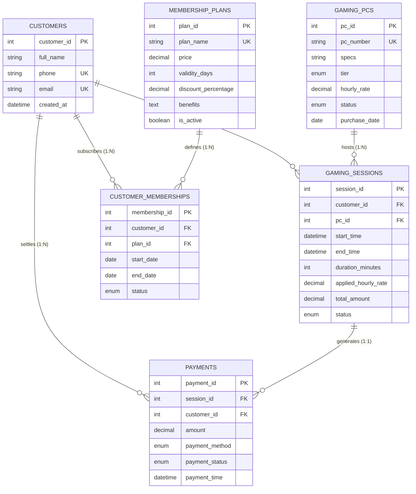

# ARCADIA — Gaming Cafe Management System (DBMS Project)

ARCADIA is an enterprise-grade full-stack web application and MySQL database architecture designed to manage esports gaming cafes, hardware fleet allocations, minute-based billing sessions, customer memberships, and financial ledger receipts.

---

## 1. Quick Local Setup Guide (Windows, VS Code & MySQL)

Follow these step-by-step instructions to run the project locally on your laptop:

### Prerequisites:
1. **Node.js (LTS version 18 or 20):** Download from [nodejs.org](https://nodejs.org/) and install.
2. **MySQL Server 8.0:** Download MySQL Installer from [dev.mysql.com/downloads/installer/](https://dev.mysql.com/downloads/installer/). During setup, set a password for the `root` user (remember this password!).
3. **MySQL Workbench:** Included in the MySQL Installer or downloaded separately.
4. **Visual Studio Code:** Download and install from [code.visualstudio.com](https://code.visualstudio.com/).

---

### Step 1: Initialize the MySQL Database

1. Open **MySQL Workbench**.
2. Connect to your local MySQL instance (e.g., `localhost:3306`, user: `root`).
3. Click **File -> Open SQL Script...** and run the following scripts **in this exact sequence**:
   - `database/schema.sql` (Creates database, 8 tables, indexes, and foreign keys)
   - `database/seed.sql` (Populates customers, rigs, tiers, and sample sessions)
   - `database/views.sql` (Installs `vw_dashboard_kpis`, `vw_active_sessions_live`, and `vw_customer_roster`)
   - `database/triggers.sql` (Installs automated rig state synchronization and guards)
   - `database/procedures.sql` (Installs `sp_start_gaming_session`, `sp_end_session_and_settle`, and `sp_cursor_financial_audit`)
4. Verify by opening `database/verification.sql` and executing it. All queries should return valid rows without errors!

---

### Step 2: Configure Environment Variables

1. Open the project folder in **Visual Studio Code**.
2. Copy `.env.example` to a new file named `.env`:
   ```bash
   cp .env.example .env
   ```
3. Edit the `.env` file with your local MySQL password:
   ```env
   PORT=3000
   DB_HOST=localhost
   DB_USER=root
   DB_PASSWORD=YOUR_ACTUAL_MYSQL_PASSWORD
   DB_NAME=arcadia_db
   DB_PORT=3306
   JWT_SECRET=arcadia_super_secret_cyber_jwt_key_99482
   ```

---

### Step 3: Install Node Dependencies & Run

1. Open the VS Code integrated terminal (`Ctrl + ~` or **Terminal -> New Terminal**).
2. Install npm dependencies:
   ```bash
   npm install
   ```
3. Start the application:
   ```bash
   npm run dev
   ```
4. Open your web browser (Chrome, Edge, Brave) and navigate to:
   ```text
   http://localhost:3000/
   ```

---

## 2. Relational Database Concepts & Schema Proof

### Normalization Proof (3NF / BCNF)
- **1NF (First Normal Form):** Every table attribute holds only atomic values. There are no repeating groups or comma-separated lists. For example, `specs` and `benefits` are scalar strings; multi-item transactions and session durations are recorded in discrete normalized rows.
- **2NF (Second Normal Form):** The schema is in 1NF, and all non-prime attributes are fully functionally dependent on the candidate key. In junction tables like `customer_memberships`, the table uses a surrogate primary key (`membership_id`), preventing partial functional dependencies.
- **3NF (Third Normal Form):** The schema is in 2NF and contains no transitive functional dependencies ($X \to Y \land Y \to Z$). For instance, membership discount rates are not stored redundantly in the `customers` table; they are looked up dynamically from `membership_plans`.

---

### Entity-Relationship (ER) Diagram (Mermaid)



---

## 3. Stored Procedures, Triggers & Cursors

### 1. Stored Procedure: `sp_start_gaming_session`
- **Location:** `database/procedures.sql`
- **Purpose:** Verifies that the requested gaming PC is `Available`. Computes whether the player has an active membership tier discount. Computes effective hourly rate and creates the active session.

### 2. Stored Procedure with ACID Transaction: `sp_end_session_and_settle`
- **Location:** `database/procedures.sql`
- **ACID Implementation:**
  - `START TRANSACTION`: Begins atomic boundary.
  - `FOR UPDATE`: Locks the active session row against race conditions.
  - Computes exact duration and proportional pro-rata billing:
    $$\text{Total Amount} = \text{ROUND}\left(\frac{\text{Duration Minutes}}{60.0} \times \text{Effective Rate}, 2\right)$$
  - Updates `gaming_sessions` to `Completed`.
  - Inserts receipt into `payments`.
  - `COMMIT` guarantees either both records are saved or neither is saved (`ROLLBACK` on exception).

### 3. MySQL Triggers:
- `trg_after_session_insert`: Automatically flips the PC status from `Available` to `In Use`.
- `trg_before_session_insert_guard`: Rejects sessions if the rig is `In Use` or `Maintenance`.
- `trg_after_session_update_release`: Automatically restores PC status to `Available` when a session concludes.

### 4. MySQL Cursor Implementation: `sp_cursor_financial_audit`
- **Purpose:** Reconciles daily transaction revenue row-by-row using an explicit MySQL cursor:
  ```sql
  DECLARE cur_payments CURSOR FOR 
      SELECT amount, payment_method FROM payments WHERE ...;
  DECLARE CONTINUE HANDLER FOR NOT FOUND SET v_done = TRUE;
  OPEN cur_payments;
  audit_loop: LOOP
      FETCH cur_payments INTO v_amount, v_method;
      IF v_done THEN LEAVE audit_loop; END IF;
      -- Accumulate subtotals by payment method
  END LOOP;
  CLOSE cur_payments;
  ```

---

## 4. College Viva / Exam Questions & Model Answers

### Q1: What is ACID, and how is it demonstrated in ARCADIA?
**Answer:** ACID stands for Atomicity, Consistency, Isolation, and Durability. In ARCADIA, it is implemented in stored procedure `sp_end_session_and_settle`. Atomicity ensures that concluding the session and recording the payment receipt succeed together or fail together. Isolation is maintained using row-level locking (`SELECT ... FOR UPDATE`). Consistency is enforced via table constraints and foreign keys. Durability is provided by the MySQL InnoDB write-ahead transaction log.

### Q2: Why use a Trigger to update PC availability rather than application code?
**Answer:** Database triggers enforce business rules at the data layer, ensuring that whenever a session record is inserted into `gaming_sessions`, the corresponding rig is guaranteed to be set to `In Use`, regardless of which API, stored procedure, or administrative client initiated the insert.

### Q3: When is a CURSOR required, and why are set-based queries usually preferred?
**Answer:** SQL is inherently optimized for set-based operations (like `SUM()` and `GROUP BY`). However, a cursor is necessary when complex procedural row-by-row logic, custom conditional validation, or multi-step iterative computations must take place within a stored procedure.
